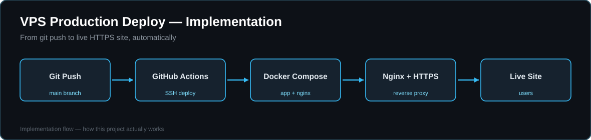

# VPS Production Deploy — Docker + Nginx + HTTPS + CI/CD




A complete, reusable blueprint for deploying a web app to a single VPS the production way: containerised app, Nginx reverse proxy, free HTTPS via Let's Encrypt, and automatic deployment on every push to `main`.

This is the exact setup I deliver for clients who have an app and a VPS (or want one) and need it live, secure and self-deploying.

## Architecture

```
Internet → Nginx (80/443, TLS) → Gunicorn/Flask app container
                ↑
GitHub push → GitHub Actions → SSH into VPS → docker compose up -d --build
```

## What's inside

- `app/` — sample Flask app with a multi-stage Dockerfile (small runtime image, non-root user, healthcheck) served by Gunicorn
- `docker-compose.yml` — app + Nginx + optional Certbot profile for SSL
- `nginx/app.conf` — reverse proxy config: HTTP→HTTPS redirect, ACME challenge path, proxy headers
- `.github/workflows/deploy.yml` — CI/CD: on push to `main`, SSH into the VPS, pull, rebuild and restart with zero manual steps

## Setup (15 minutes)

1. Clone this repo onto your VPS at `/opt/vps-production-deploy`
2. Point your domain's DNS A record at the VPS IP, and replace `example.com` in `nginx/app.conf` with your domain
3. Issue the first certificate:
   ```bash
   docker compose run --rm certbot certonly --webroot -w /var/www/certbot -d example.com -d www.example.com
   ```
   (Temporarily comment the HTTPS server block for the very first run if Nginx refuses to start without certs.)
4. Start everything: `docker compose up -d --build`
5. Add three GitHub repo secrets — `VPS_HOST`, `VPS_USER`, `VPS_SSH_KEY` — and every push to `main` now deploys itself

## Notes

- HTTPS certificates auto-renew by re-running the certbot service on a cron schedule
- The app container is not exposed directly; only Nginx publishes ports
- Built as a hands-on reference implementation of the deployment service I sell — adapt the app service to any stack (Node, Django, Laravel) by swapping the Dockerfile
